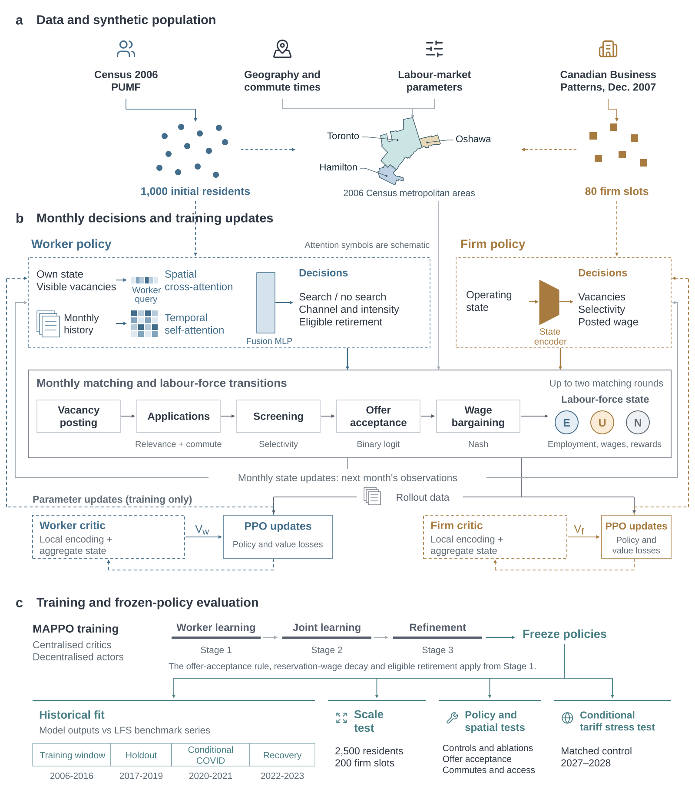
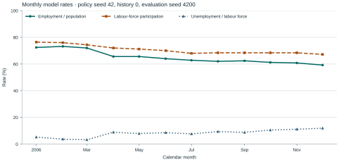

<a name="readme-top"></a>

<p align="center">
  <picture>
    <source media="(prefers-color-scheme: dark)" srcset="docs/banner_dark.svg">
    <source media="(prefers-color-scheme: light)" srcset="docs/banner_light.svg">
    
  </picture>
</p>

<p align="center">
  
  
  
  
  
</p>

<h1 align="center">An agent-based metropolitan labour-market microsimulation with jointly learned worker and firm decisions</h1>

<p align="center">
  <a href="#overview">Overview</a> ·
  <a href="#system-requirements">Requirements</a> ·
  <a href="#installation">Installation</a> ·
  <a href="#demonstration">Demonstration</a> ·
  <a href="#instructions-for-use">Instructions for use</a> ·
  <a href="#repository-layout">Layout</a> ·
  <a href="#citation">Citation</a>
</p>

This repository contains the code for the paper of the same title. The paper presents a census-based microsimulation of the Greater Toronto and Hamilton Area in which workers and firms learn search and hiring jointly through multi-agent reinforcement learning.

The market starts in 2006 with 1,000 residents and 80 firm slots in 17 industries. Worker attributes come from the 2006 Census and the firm roster from Canadian Business Counts. Residents and firms are located in the region's three census metropolitan areas, Oshawa, Toronto and Hamilton. Each month residents are employed, unemployed or outside the labour force, and they move between these states through search, hiring, separation, retirement and re-entry. Where a worker lives and where a job is located set the commute, so workers who face the same regional vacancy rate can reach different jobs.

## Overview

<p align="center">
  
</p>

Model framework. Panel **a** shows the data sources and the three census metropolitan areas, panel **b** the monthly decisions and training updates, and panel **c** the training and evaluation design. The locator map is adapted from Statistics Canada, 2006 Census metropolitan area and census agglomeration digital boundary file (gcma000a06a_e). This does not constitute an endorsement by Statistics Canada of this product.

### One month in the model

<table>
  <tr>
    <td width="50%" valign="top">
      <b>Workers</b><br>
      Each month workers choose how to search and whether to retire when eligible.
    </td>
    <td width="50%" valign="top">
      <b>Firms</b><br>
      Firms choose vacancies, selectivity and posted wages.
    </td>
  </tr>
</table>
<table>
  <tr>
    <td width="50%" valign="top">
      <b>Matching</b><br>
      Screening, offer acceptance and wage bargaining determine which matches become hires. The acceptance rule weighs commute time alongside pay, skill match and job security.
    </td>
    <td width="50%" valign="top">
      <b>Population</b><br>
      The resident population renews every July, and funded job capacity changes with population size.
    </td>
  </tr>
</table>

### Training and evaluation

Training has three stages.

| Stage 1 | Stage 2 | Stage 3 |
| --- | --- | --- |
| Workers learn against a fixed firm rule. | Workers and firms learn jointly. | A refinement stage follows. |

Learning uses multi-agent proximal policy optimisation with dual-transformer worker policies and a separate firm policy. The policies are frozen for evaluation. The evaluation compares the trained policies with two untrained controls and isolates the contribution of learned firm decisions. It also covers the offer-acceptance, scale, pandemic and tariff experiments of the paper.

## System requirements

The code is written in Python and needs no non-standard hardware. The demonstration below runs on two CPU cores with 8 GB of memory. A GPU shortens full training. The code has been run with the following versions.

| | Workstation | Cluster | Demonstration test |
| --- | --- | --- | --- |
| Operating system | Windows | Linux | Linux x86-64 |
| Python | 3.13.14 | 3.11.5 | 3.13.18 |
| torch | 2.11.0+cu128 | 2.10.0 | 2.11.0 (CPU run) |
| torchrl | 0.13.3 | 0.11.0 | 0.13.3 |
| tensordict | 0.13.0 | 0.11.0 | 0.13.0 |
| numpy | 2.5.1 | 2.4.2 | 2.5.5 |
| pandas | 2.2.3 | 3.0.0 | 2.3.3 |
| scipy | 1.18.0 | 1.17.0 | 1.18.1 |

`requirements.txt` lists the packages to install. It fixes torch, torchrl and tensordict at the versions of the first column and accepts a range of versions for the other packages. Main Figures 1, 4 and 5 are drawn as SVG files and converted to PDF with [Inkscape](https://inkscape.org/), a free drawing program, so rendering these three figures also requires Inkscape.

## Installation

Use a virtual environment. From the unpacked repository directory, run

```sh
python -m venv .venv
```

Activate it with `source .venv/bin/activate` on Linux or macOS, or `.\.venv\Scripts\Activate.ps1` in Windows PowerShell. Install the Python dependencies into it.

```sh
python -m pip install -r requirements.txt
```

Installation takes about four minutes on a standard connection. On Linux, pip installs the CUDA build of PyTorch by default, which is larger than the CPU build and also runs on a machine without a GPU. For GPU training, install the PyTorch build that matches your CUDA driver.

## Demonstration

The three commands below train a policy on the synthetic example, simulate one year with it and plot the result.

```sh
python train.py --data synthetic_data/example --output demo/policy42 --seed 42 --demo
python -m evaluation.run historical --data synthetic_data/example --checkpoint demo/policy42/stage3/final_checkpoint.pt --seed 42 --history 0 --workers 250 --firms 80 --months 12 --output demo/history42
python figures/render.py --history demo/history42/monthly.csv --output demo/history-figure
```

| Command | What it does | What it writes |
| :---: | --- | --- |
| 1 | Runs one short update in each stage | `demo/policy42/stage3/final_checkpoint.pt`, and `demo/policy42/stage1/initial_checkpoint.pt` for the untrained comparisons |
| 2 | Simulates one year with the trained policy | `history.json`, `simulation_log.json`, `monthly.json` and `monthly.csv` in `demo/history42` |
| 3 | Plots the employment, participation and unemployment rates of that history | `labour_market_rates.svg` and `labour_market_rates.pdf` in `demo/history-figure` |

On the tested CPU configuration, training takes about two minutes and the one-year history takes 10 to 20 seconds. Choose a fresh output directory for each run.

### Expected output on the synthetic example

<p align="center">
  
</p>

The figure written by the third command on the tested configuration. It shows the synthetic example and is not a result of the paper.

### Plotting fixture

The plotting commands can also be tried on their own fixture.

```sh
python figures/example.py demo/figure-inputs
python figures/render.py --inputs demo/figure-inputs --output demo/figures --figure Fig3 S9
```

This fixture is separate from the policy trained above. Its values illustrate the required inputs.

## Instructions for use

### Training

For the full training schedule, omit `--demo`. The standard configuration uses 1,000 initial residents, 80 firms and 195, 200 and 100 updates in the three stages. Each update uses 1,024 rollout steps. Use `--device cuda` for GPU training. Each policy seed needs its own training run and output directory. The paper uses five policy seeds, 42 to 46.

### Evaluation

The evaluation code covers the historical period, age profiles, recruitment, the two evaluation-only controls, the firm-policy intervention, offer acceptance, commuting and vacancy access, and the pandemic and tariff scenarios. The [evaluation guide](evaluation/README.md) gives the command for each analysis and defines every reported rate. Across-policy estimates in the paper require the five separately trained policies and their matched histories.

### Figures

The figure commands read source tables and write vector figures. The [figure guide](figures/README.md) maps all 24 main, Extended Data and supplementary figures to their inputs.

### Running on other data

`--data` names a directory with the layout of `synthetic_data/example`. To write another synthetic dataset, use `python synthetic_data/make_synthetic_data.py --out demo/data --seed 43` and pass that directory to both training and evaluation. The generator writes every table the model reads, with the same columns as the study inputs.

<details>
<summary><b>Tables of the data directory</b></summary>

| Path under the data directory | Contents |
| --- | --- |
| `Data_Agents/Microsim_Output/population_2006.csv` | One row per synthetic resident in 2006 with age, sex, education, skill level, labour-force status, industry, wage, tenure, immigrant status, home dissemination area, metropolitan area and weight |
| `Data_Agents/firm_population/firms_2006.csv` | One row per synthetic establishment with industry, employment size, sector, dissemination area and metropolitan area |
| `Data_Agents/firm_population/firm_location_provenance.json` | Record of how establishment locations were assigned |
| `Data/Simulation/Parameters/labor_force_summary_2006_2016.csv` | Annual unemployment, employment and participation rates |
| `Data/Simulation/Parameters/job_finding_rates_2006_2016.csv` | Monthly job-finding rate by year and age group |
| `Data/Simulation/Parameters/separation_rates_2006_2016.csv` | Separation and layoff rates by year and industry |
| `Data/Simulation/Parameters/wage_parameters_2006_2016.csv` | Average hourly wage and wage growth by year and industry |
| `Data/Simulation/Parameters/labor_force_transitions_2006_2016.csv` | Discouragement rate and retirement share by year and age group |
| `Data/Simulation/Parameters/nilf_composition_2006_2016.csv` and `nilf_composition_by_sex_2006_2016.csv` | Reasons for being outside the labour force by year and age group, overall and by sex |
| `Data/Simulation/Parameters/mortality_rates.csv` | Annual probability of death by single year of age |
| `Data/Simulation/Parameters/retirement_rates.csv` | Retirement rate by single year of age |
| `Data/Simulation/Parameters/immigration_emigration_ontario.csv` and `gtha_share.csv` | Annual immigrants and emigrants and the regional share of the provincial population |
| `Data/Simulation/Parameters/cohort_population.csv` | Population by year, metropolitan area and single year of age |
| `Data/Simulation/Parameters/net_projection.csv` and `net_projection.json` | Net change in the adult population for 2026 to 2030 and its record |
| `Data/Simulation/Parameters/recession_multipliers.csv` | Annual multipliers for job finding and separation |
| `Data/Simulation/Parameters/firm_size_probabilities.csv` | Share of small and medium establishments by industry |
| `Data/Simulation/Parameters/da_centroids_gtha.csv` | Latitude and longitude of each dissemination area |
| `Data/Simulation/Parameters/workplace/` | 2006 employment by workplace area, industry and class of worker, and commuting flows between areas |

</details>

Tables with the suffix `_2017_2025` extend the five rate tables beyond 2016 and are read when present. The scenarios that run past 2016 use them.

The study inputs come from the Statistics Canada 2006 Census Individuals public-use microdata file, a custom tabulation of Canadian Business Counts, the Labour Force Survey public-use microdata files for 2006 to 2016, the Job Vacancy and Wage Survey, Ontario life tables and published pandemic drivers. The Data availability statement of the paper lists them with their catalogue and table numbers. Derived population files embed licensed inputs and are not redistributed.

Travel-time and other derived tables are cached under the user cache directory in a folder named `metropolitan-labour-market`. Set the environment variable `METRO_CACHE_DIR` to use another location.

## Repository layout

| Path | Contents |
| --- | --- |
| [`gtha_labor_marl/`](gtha_labor_marl) | Market environment, worker and firm policies, rewards, training implementation and stage settings |
| [`train.py`](train.py) | Three-stage training entry point |
| [`synthetic_data/`](synthetic_data) | Synthetic demonstration dataset and the generator that creates it |
| [`evaluation/`](evaluation) | Evaluation scenarios, outcome collectors and scoring |
| [`figures/`](figures) | Figure recipes and plotting example |
| [`docs/`](docs) | Images shown on this page |

## Citation

If you use this code, please cite the paper. The reference and the DOI of the archived release will be added here on publication. Until then, please cite this repository.

```bibtex
@misc{Waqfi2026GTHAMARL,
  author       = {Waqfi, Lina and Farooq, Bilal and Patterson, Zachary},
  title        = {{GTHA-MARL}},
  year         = {2026},
  publisher    = {GitHub},
  journal      = {GitHub repository},
  howpublished = {\url{https://github.com/LiTrans/GTHA-MARL}},
  note         = {Commit: 0804422}
}
```

## Licence

The source code is distributed under the terms in [LICENSE](LICENSE).

<p align="center"><a href="#readme-top">Back to top</a></p>
