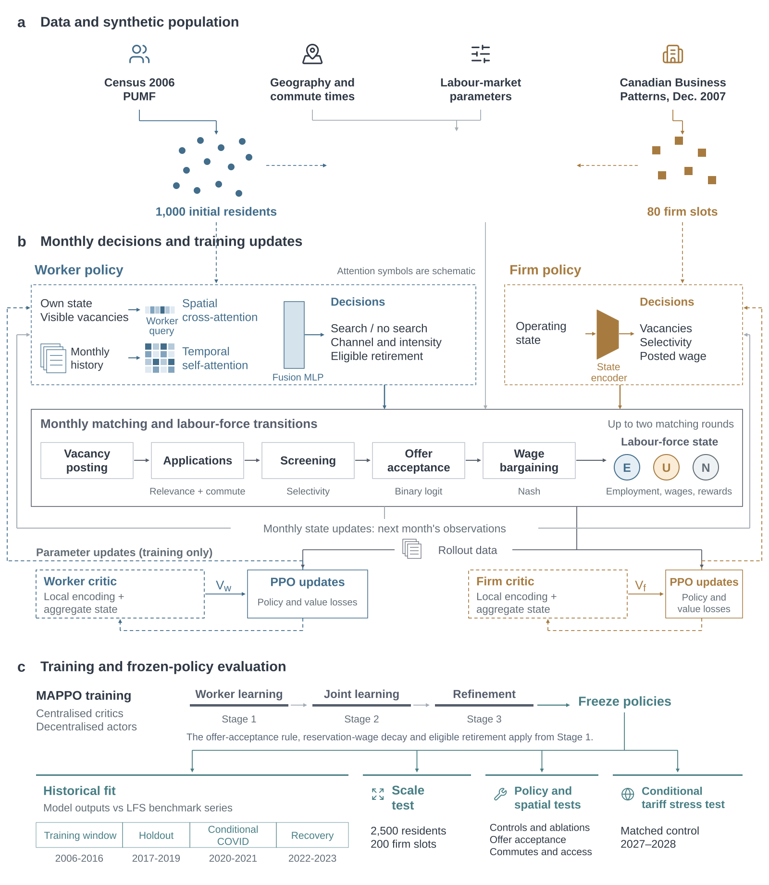

# An agent-based metropolitan labour-market microsimulation with jointly learned worker and firm decisions

This repository holds the code for the paper of the same title. The model simulates monthly worker search, firm recruitment and matching in the Toronto, Oshawa and Hamilton census metropolitan areas. Workers and firms have separate policies. A three-stage reinforcement learning curriculum trains them in the same simulated market. Population renewal, workplace capacity and commuting constraints affect who can take which job.



All simulation, training, evaluation and figure-generation code is included. The project data cannot be shared, so the repository provides synthetic data for code demonstration. The code is therefore not expected to reproduce the results reported in the paper quantitatively.

## System requirements

The code is written in Python and needs no non-standard hardware. The demonstration below runs on two CPU cores with 8 GB of memory. A GPU shortens full training. The code has been run with the following versions.

| | Workstation | Cluster | Demonstration test |
| --- | --- | --- | --- |
| Operating system | Windows | Linux | Linux x86-64 |
| Python | 3.13.14 | 3.11.5 | 3.13.18 |
| torch | 2.11.0+cu128 | 2.10.0 | 2.11.0 (CPU run) |
| torchrl | 0.13.3 | 0.11.0 | 0.13.3 |
| tensordict | 0.13.0 | 0.11.0 | 0.13.0 |
| numpy | 2.5.1 | 2.4.2 | 2.5.5 |
| pandas | 2.2.3 | 3.0.0 | 2.3.3 |
| scipy | 1.18.0 | 1.17.0 | 1.18.1 |

`requirements.txt` pins the versions of the first column for torch, torchrl and tensordict and gives ranges for the other packages. Rendering the vector layouts for main Figures 1, 4 and 5 also requires [Inkscape](https://inkscape.org/).

## Installation

Use a virtual environment. From the unpacked repository directory, run

```sh
python -m venv .venv
```

Activate it with `source .venv/bin/activate` on Linux or macOS, or `.\.venv\Scripts\Activate.ps1` in Windows PowerShell. Install the Python dependencies into it.

```sh
python -m pip install -r requirements.txt
```

Installation takes about four minutes on a standard connection. On Linux, pip installs the CUDA build of PyTorch by default, which is larger than the CPU build and also runs on a machine without a GPU. For GPU training, install the PyTorch build that matches your CUDA driver.

## Demonstration

The three commands below train a policy on the synthetic example, simulate one year with it and plot the result.

```sh
python train.py --data synthetic_data/example --output demo/policy42 --seed 42 --demo
python -m evaluation.run historical --data synthetic_data/example --checkpoint demo/policy42/stage3/final_checkpoint.pt --seed 42 --history 0 --workers 250 --firms 80 --months 12 --output demo/history42
python figures/render.py --history demo/history42/monthly.csv --output demo/history-figure
```

The first command runs one short update in each stage and writes `demo/policy42/stage3/final_checkpoint.pt`. It also saves `demo/policy42/stage1/initial_checkpoint.pt` for the untrained comparisons. The second command writes `history.json`, `simulation_log.json`, `monthly.json` and `monthly.csv` to `demo/history42`. The third writes a figure of the employment, participation and unemployment rates of that history.

Expected output. On the tested CPU configuration, training takes about two minutes and the one-year history takes 10 to 20 seconds. With seed 42 the first data row of `demo/history42/monthly.csv` gives an employment rate of 0.724, a participation rate of 0.764 and an unemployment rate of 0.0524. All rates in that file are fractions. Values can differ in the last digits across library versions and hardware. Choose a fresh output directory for each run.

The plotting commands can also be tried on their own fixture.

```sh
python figures/example.py demo/figure-inputs
python figures/render.py --inputs demo/figure-inputs --output demo/figures --figure Fig3 S9
```

This fixture is separate from the policy trained above. Its values illustrate the required inputs.

## Instructions for use

### Training

For the full training schedule, omit `--demo`. The standard configuration uses 1,000 initial residents, 80 firms and 195, 200 and 100 updates in the three stages. Each update uses 1,024 rollout steps. Use `--device cuda` for GPU training. Each policy seed needs its own training run and output directory. The paper uses five policy seeds, 42 to 46.

### Evaluation

The evaluation code covers the historical period, age profiles, recruitment, the two evaluation-only controls, the firm-policy intervention, offer acceptance, commuting and vacancy access, and the pandemic and tariff scenarios. The [evaluation guide](evaluation/README.md) gives the command for each analysis and defines every reported rate. Across-policy estimates in the paper require the five separately trained policies and their matched histories.

### Figures

The figure commands read source tables and write vector figures. The [figure guide](figures/README.md) maps all 24 main, Extended Data and supplementary figures to their inputs.

### Running on other data

`--data` names a directory with the layout of `synthetic_data/example`. To write another synthetic dataset, use `python synthetic_data/make_synthetic_data.py --out demo/data --seed 43` and pass that directory to both training and evaluation. The generator writes every table the model reads, with the same columns as the study inputs.

| Path under the data directory | Contents |
| --- | --- |
| `Data_Agents/Microsim_Output/population_2006.csv` | One row per synthetic resident in 2006 with age, sex, education, skill level, labour-force status, industry, wage, tenure, immigrant status, home dissemination area, metropolitan area and weight |
| `Data_Agents/firm_population/firms_2006.csv` | One row per synthetic establishment with industry, employment size, sector, dissemination area and metropolitan area |
| `Data_Agents/firm_population/firm_location_provenance.json` | Record of how establishment locations were assigned |
| `Data/Simulation/Parameters/labor_force_summary_2006_2016.csv` | Annual unemployment, employment and participation rates |
| `Data/Simulation/Parameters/job_finding_rates_2006_2016.csv` | Monthly job-finding rate by year and age group |
| `Data/Simulation/Parameters/separation_rates_2006_2016.csv` | Separation and layoff rates by year and industry |
| `Data/Simulation/Parameters/wage_parameters_2006_2016.csv` | Average hourly wage and wage growth by year and industry |
| `Data/Simulation/Parameters/labor_force_transitions_2006_2016.csv` | Discouragement rate and retirement share by year and age group |
| `Data/Simulation/Parameters/nilf_composition_2006_2016.csv` and `nilf_composition_by_sex_2006_2016.csv` | Reasons for being outside the labour force by year and age group, overall and by sex |
| `Data/Simulation/Parameters/mortality_rates.csv` | Annual probability of death by single year of age |
| `Data/Simulation/Parameters/retirement_rates.csv` | Retirement rate by single year of age |
| `Data/Simulation/Parameters/immigration_emigration_ontario.csv` and `gtha_share.csv` | Annual immigrants and emigrants and the regional share of the provincial population |
| `Data/Simulation/Parameters/cohort_population.csv` | Population by year, metropolitan area and single year of age |
| `Data/Simulation/Parameters/net_projection.csv` and `net_projection.json` | Net change in the adult population for 2026 to 2030 and its record |
| `Data/Simulation/Parameters/recession_multipliers.csv` | Annual multipliers for job finding and separation |
| `Data/Simulation/Parameters/firm_size_probabilities.csv` | Share of small and medium establishments by industry |
| `Data/Simulation/Parameters/da_centroids_gtha.csv` | Latitude and longitude of each dissemination area |
| `Data/Simulation/Parameters/workplace/` | 2006 employment by workplace area, industry and class of worker, and commuting flows between areas |

Tables with the suffix `_2017_2025` extend the five rate tables beyond 2016 and are read when present. The scenarios that run past 2016 use them.

The study inputs come from the Statistics Canada 2006 Census Individuals public-use microdata file, a custom tabulation of Canadian Business Counts, the Labour Force Survey public-use microdata files for 2006 to 2016, the Job Vacancy and Wage Survey, Ontario life tables and published pandemic drivers. The Data availability statement of the paper lists them with their catalogue and table numbers. Derived population files embed licensed inputs and are not redistributed.

Travel-time and other derived tables are cached under the user cache directory in a folder named `metropolitan-labour-market`. Set the environment variable `METRO_CACHE_DIR` to use another location.

## Repository layout

| Path | Contents |
| --- | --- |
| `gtha_labor_marl/` | Market environment, worker and firm policies, rewards, training implementation and stage settings |
| `train.py` | Three-stage training entry point |
| `synthetic_data/` | Synthetic demonstration dataset and the generator that creates it |
| `evaluation/` | Evaluation scenarios, outcome collectors and scoring |
| `figures/` | Figure recipes and plotting example |

## Citation

If you use this code, please cite the paper. The reference and the DOI of the archived release will be added here on publication.

## Licence

The source code is distributed under the terms in [LICENSE](LICENSE).
